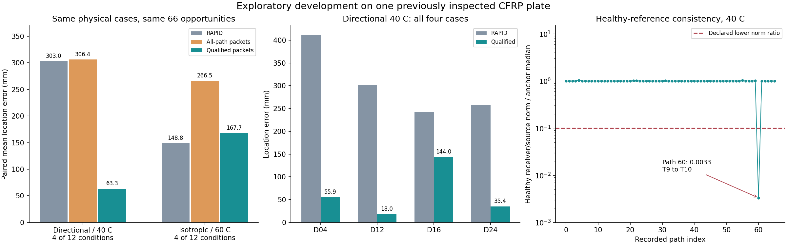
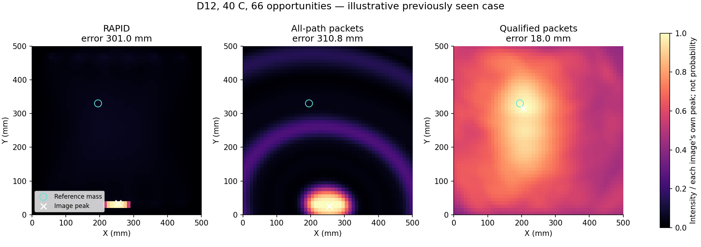

# Wave-packet development results — 12 October 2026

This development iteration improves the operator UI, adds time-resolved
experimental imaging, and identifies a concrete reference-validity issue.
It does not establish field detection, a new patentable method or a successful
complete-temperature localization model. Both experiments use previously
inspected OGW measurements from one plate and four collinear removable mass
positions. No new physical acquisition was performed.

## Measured comparisons and coverage

Healthy-only propagation calibration qualified two of six models. Four fits
reached the declared instrument-delay bound; their results remain unsupported.
The first experiment used all recorded paths and worsened localization.
The second uses paths that agree with the healthy delay fit and pass a
source-normalized healthy-reference norm check. These are exploratory revisions,
not untouched confirmation.

All errors below compare exactly the same eligible four position/temperature
cases. Each method consumes 66 common recorded opportunities, including rejected
ones. The directional branch contributes 45 paths, and the isotropic branch 36.

| Branch | Usable damage conditions | RAPID (mm) | All-path packet (mm) | Qualified packet (mm) |
|---|---:|---:|---:|---:|
| Directional, 40 C | 4 / 12 | 302.97 | 306.37 | 63.31 |
| Isotropic, 60 C | 4 / 12 | 148.80 | 266.52 | 167.69 |

Directional 40 C improves all four paired cases, but the D16 error remains
143.96 mm. Isotropic 60 C still performs worse than RAPID on average. Each
packet branch supports only one of three healthy comparison conditions.
Both fixed-20 packet branches remain unsupported. Missing conditions are not
excluded silently or assigned zero error.

| Directional 40 C position | RAPID error (mm) | Qualified error (mm) |
|---|---:|---:|
| D04 | 411.49 | 55.90 |
| D12 | 301.04 | 18.03 |
| D16 | 242.33 | 143.96 |
| D24 | 257.00 | 35.36 |

## What the quality gate establishes

Healthy 40 C path 60 (T9 to T10) has receiver L2 norm 0.03274 after filtering,
versus 10.21266 at 20 C and 9.85255 at 60 C. Its source-normalized norm ratio
to the three-anchor median is 0.003322. This is an amplitude/transfer
consistency proxy, not a squared physical-energy ratio or a damage probability.
A receiver dropout is a possible explanation, not a verified cause.

The implementation rejects abnormal reference ratios and paths outside the
healthy delay model's inliers. Path 60 was already excluded by the inlier rule,
so these data do not establish an independent benefit of the norm gate.
The observed improvement belongs to the combined path-qualification branch.
The raw healthy image remains descriptive; no damage threshold, sensitivity
or false-positive rate is calibrated. Test electrical source drift is not yet
corrected in this branch.

Each displayed image uses its own peak as the colour maximum. This supports
pattern inspection only; colours cannot compare absolute evidence strength
between methods. Raw intensities remain in the result files.

## Implementation and evidence

- `backend/app/evaluation/wave_packet_imaging.py`: source-correlation residual
  envelopes, bounded healthy packet-delay fits and time-resolved backprojection.
- `backend/app/evaluation/wave_packet_qualification.py`: healthy transfer-norm
  consistency and model-inlier gating, separate from damage decisions.
- [First protocol](WAVE_PACKET_IMAGING_PROTOCOL.md) and
  [qualified-path protocol](QUALIFIED_WAVE_PACKET_PROTOCOL.md).
- [First retained result](../research_results/wave_packet_imaging_development_2026_10_12.json), SHA-256
  `271107630f71de6e871af076670eeda2a80af347e8aaba11370635c457ca80f7`.
- [Qualified retained result](../research_results/qualified_wave_packet_imaging_development_2026_10_12.json), SHA-256
  `79b7bf022b1cce7d518d5c86e72e9405d2264de4c572320f74fa0f6f7be6d1e5`.

Both runs completed 270 comparison rows with unchanged source hashes.
The qualified run reproduced the first run's RAPID control exactly. Its path
sets account for every common opportunity as used, rejected or failed.
Counts reuse 18 physical banks; they are not 540 independent physical trials.

Exact sources were preserved under `output/research_sources/` in separate
`wave_packet_imaging_2026_10_12_v1` and
`qualified_wave_packet_imaging_2026_10_12_v1` snapshots, with verified SHA-256
manifests. Subsequent hardening rejects minimum-signed-integer amplitude
overflow and negative/duplicate/out-of-range calibration indices. Those fixes
do not change valid native-bank numerics; the frozen experiment sources remain
available and the experiments were not replaced after inspecting the results.

Delay-and-sum, Hilbert envelopes and directional propagation calibration are
established methods; the protocols cite primary literature. This experiment
does not establish novelty. The new branch remains offline and does not alter
production structural decisions.

Current verification passed 48 focused backend tests and 88 frontend tests,
with frontend type checking, lint and build also passing. All 15 archived source
hashes were rechecked; all 12 recorded calibrations pass the hardened index
contract, and all six healthy qualification outputs remain identical. The
scientific figures were rendered and inspected. Interactive browser visual
review remains unavailable. These checks do not establish physical performance.

## Next development step

Correct measured source timing/gain using only each captured electrical source,
then improve healthy packet identification and model identifiability without
using damaged receiver responses. Freeze the revised policy before genuinely
uninspected tests. Independent panels and a blind apparatus campaign are needed
to assess practical localization and detection; software checks cannot supply
that physical evidence.
